# 画面一覧（v0.365）

v0.365 の編集画面、ライブラリ管理、解析画面、設定画面を紹介します。使用する配布版によって画面は異なる場合があります。

画像の音色とセットは、自作の説明用サンプルです。実ユーザーのライブラリや設定は使っていません。設定画面の機器名も例示用で、接続や実機での動作確認を示すものではありません。設定画面は、項目全体を収めるため撮影時だけ横幅を広げています。

[製品紹介](../../README.md)／[操作ガイド](../USER_GUIDE.md)

## 音色編集

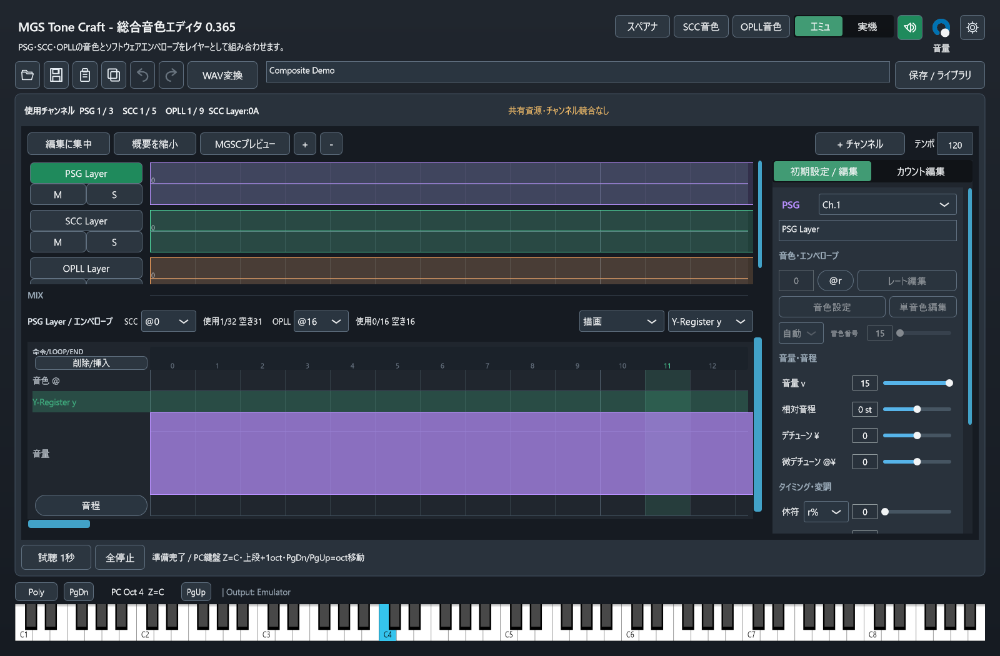

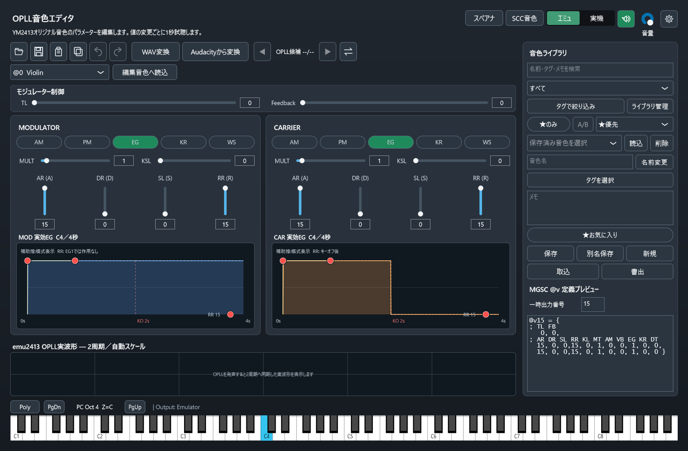

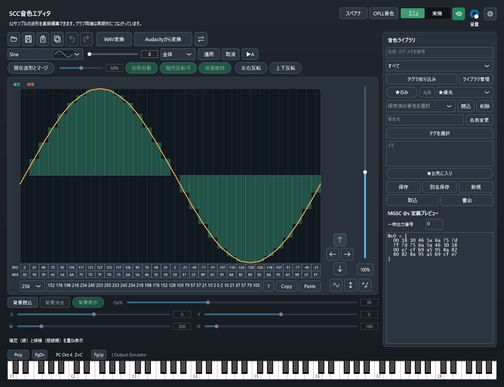

## 音色ライブラリ

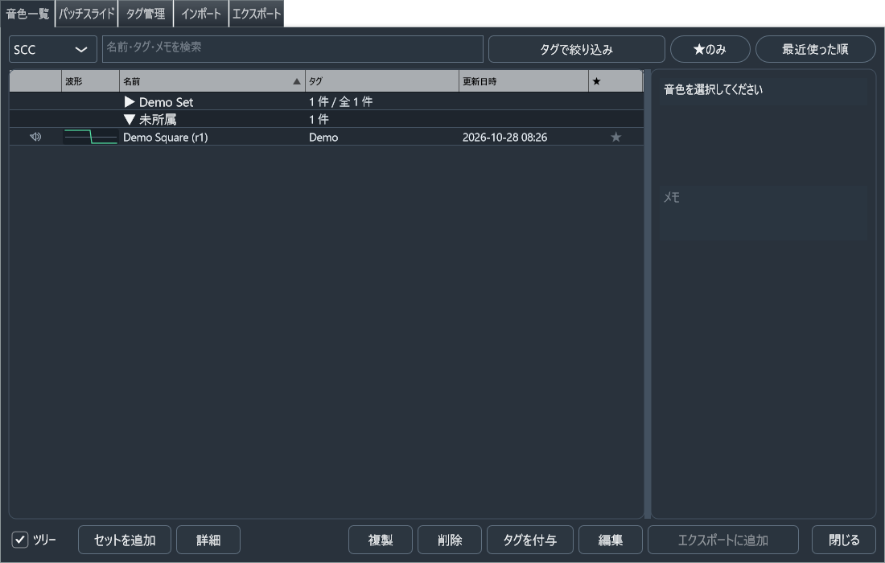

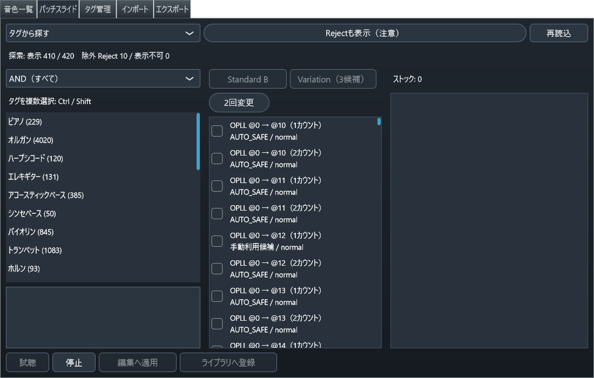

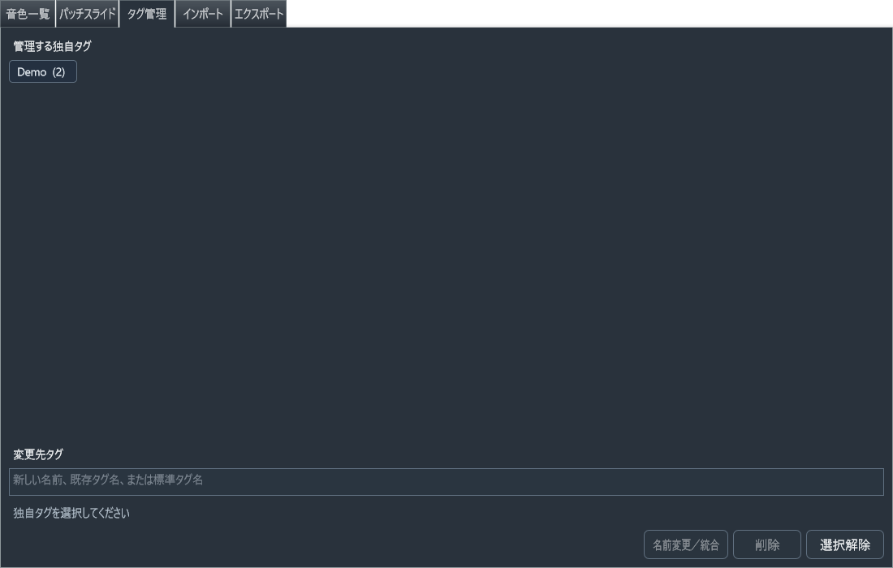

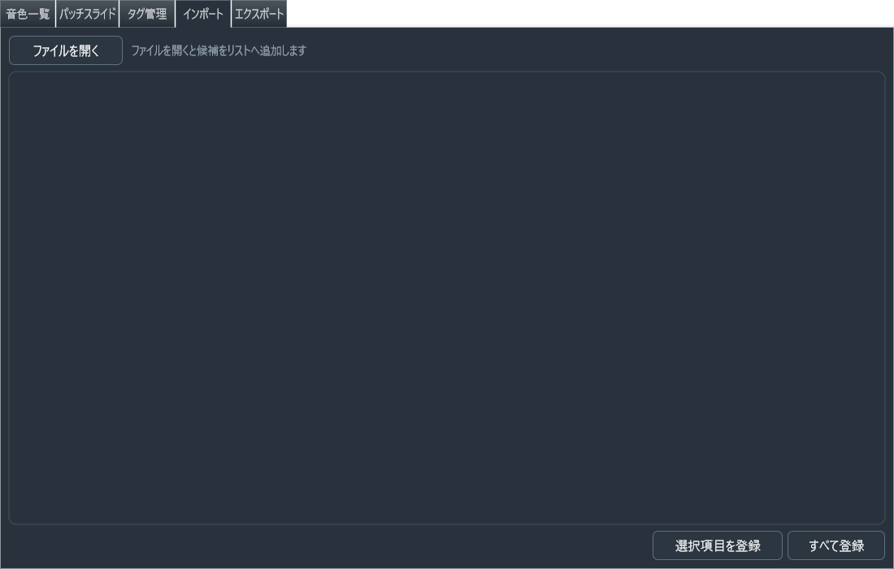

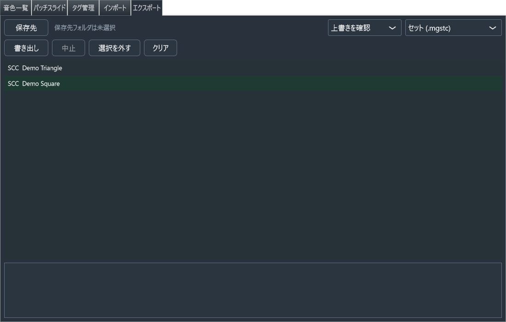

## 解析画面

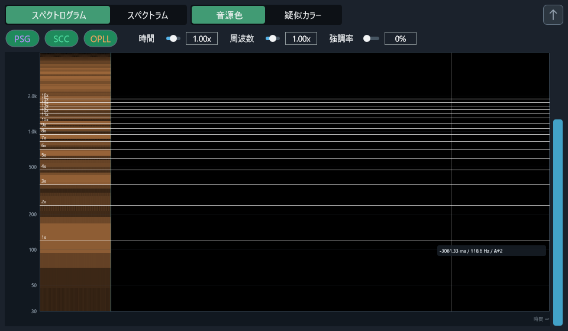

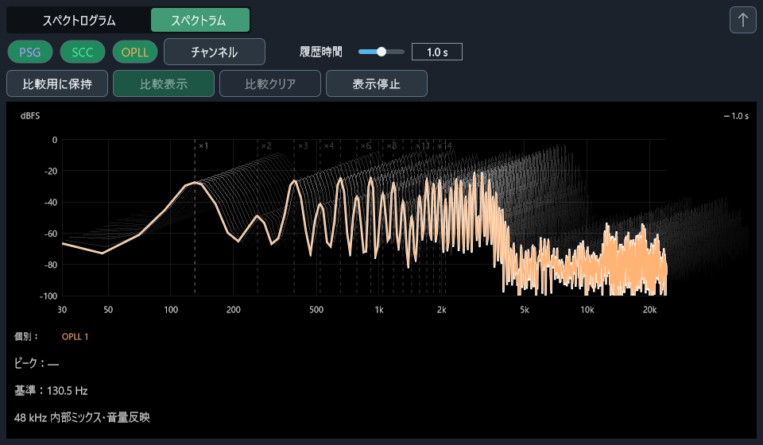

## アプリ設定

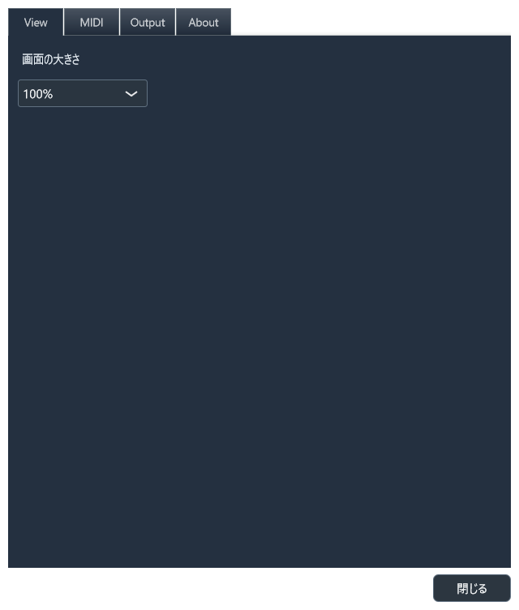

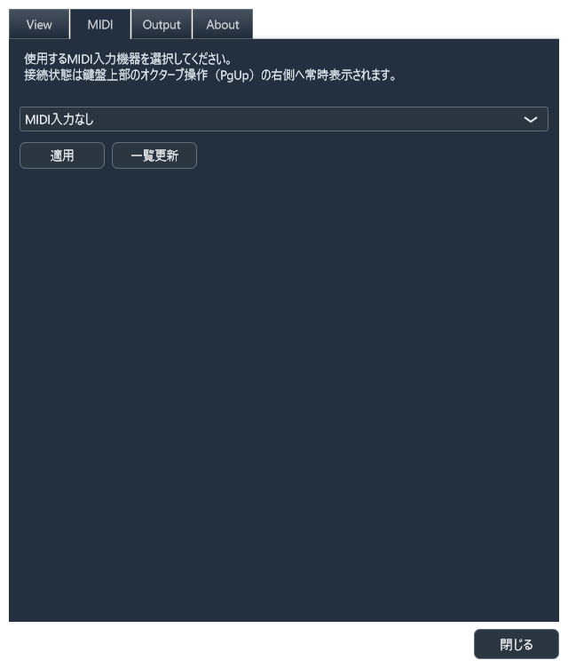

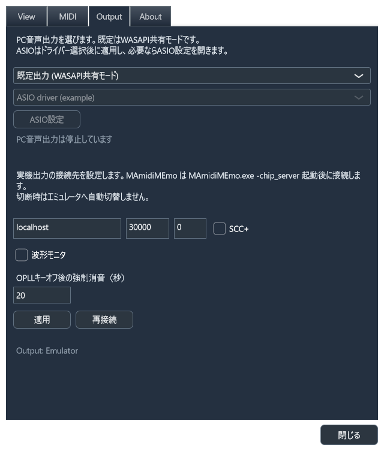

## 再撮影する場合

[ビルド手順](../../BUILDING.md)に従ってReleaseの`mgstc.exe`を用意し、以下をプロジェクトルートから実行します。撮影モードは設定とユーザー音色ライブラリを撮影専用の一時フォルダーへ隔離し、音声・MIDIデバイスや実機接続を開始しません。既存の実UIコンポーネントを描画し、PNG生成後に終了します。

```powershell
.\tools\capture-ui.cmd -Editor main -Target editor -OutputPath docs\screenshots\main.png
.\tools\capture-ui.cmd -Editor opll -Target editor -OutputPath docs\screenshots\opll-editor.png
.\tools\capture-ui.cmd -Editor scc -Target editor -OutputPath docs\screenshots\scc-editor.png
.\tools\capture-ui.cmd -Editor main -Target settings-view -OutputPath docs\screenshots\settings-view.png
.\tools\capture-ui.cmd -Editor main -Target settings-midi -OutputPath docs\screenshots\settings-midi.png
.\tools\capture-ui.cmd -Editor main -Target settings-output -OutputPath docs\screenshots\settings-output.png
.\tools\capture-ui.cmd -Editor scc -Target library -OutputPath docs\screenshots\library-manager.png
.\tools\capture-ui.cmd -Editor scc -Target library-patchslide -OutputPath docs\screenshots\patchslide.png
.\tools\capture-ui.cmd -Editor scc -Target library-tags -OutputPath docs\screenshots\library-tags.png
.\tools\capture-ui.cmd -Editor scc -Target library-import -OutputPath docs\screenshots\library-import.png
.\tools\capture-ui.cmd -Editor scc -Target library-export -OutputPath docs\screenshots\library-export.png
.\tools\capture-ui.cmd -Editor opll -Target spectrogram -OutputPath docs\screenshots\spectrogram-playing.png
.\tools\capture-ui.cmd -Editor opll -Target spectrum -OutputPath docs\screenshots\spectrum.png
```

PatchSlideの撮影には、対応する共有DB3ファイルが必要です。最大15秒のUI更新待機後に撮影するため、生成成功だけで検索結果が表示されたと判断せず画像を確認してください。公開前には画像を開き、現行画面との一致、文字化けや見切れ、個人情報の混入がないことを確認してください。画像の確認だけで、DAW・実デバイス・聴感での動作を確認したことにはなりません。

共有配置へ影響を与えず、既存のDBフォルダーを撮影専用に指定する場合:

```powershell
.\tools\capture-ui.cmd -Editor scc -Target library-patchslide -PatchSlideDirectory '<DB3ファイルのフォルダー>' -OutputPath docs\screenshots\patchslide.png
```

この指定でDBを生成・展開・更新することはありません。
